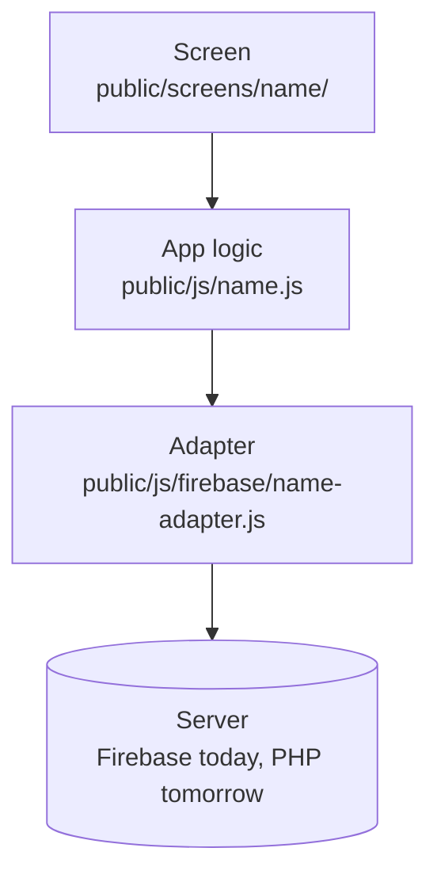
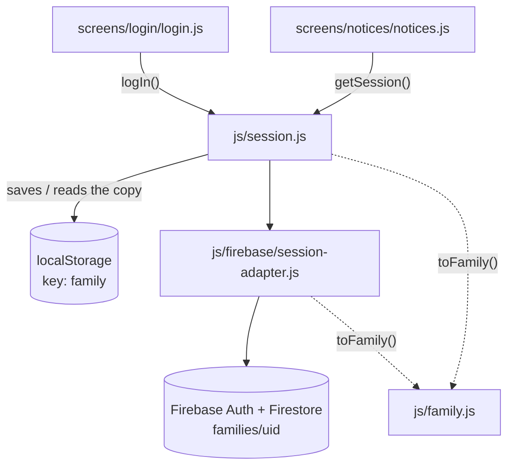
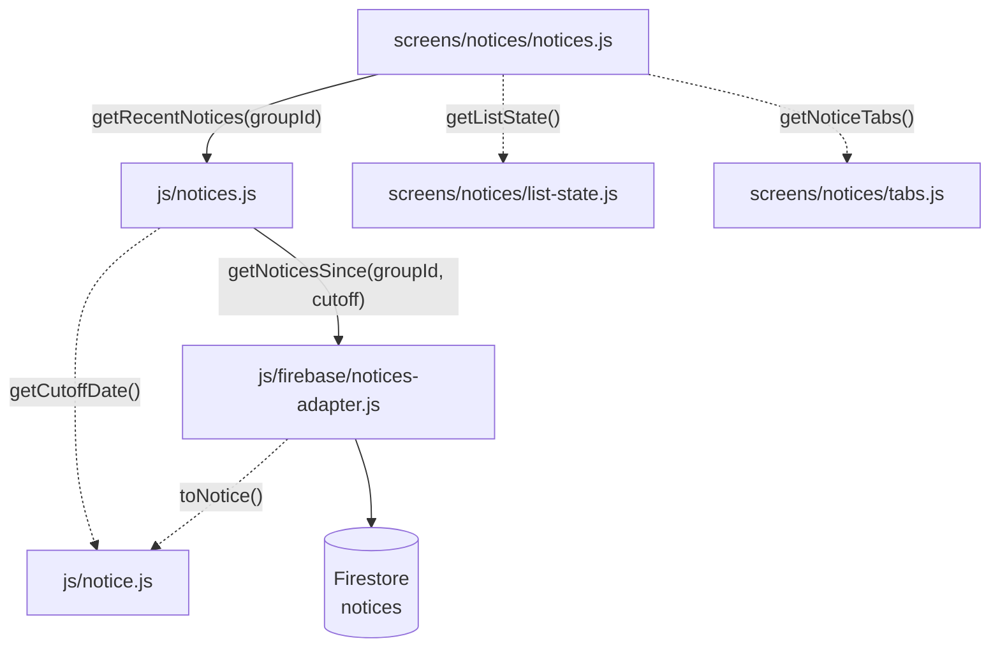

# Architecture

How Balam's files connect. The ADRs in `decisions/` explain **why**; this
page shows **what talks to what**. Update it when a flow changes.

## The layers

Every data flow goes through the same four layers. Each one only knows the
one below it.

- **Screen**: draws. Never imports Firebase.
- **App logic**: the rules (dates, the copy on the phone). It is the same
  with Firebase or PHP.
- **Adapter**: only talks to the server and turns its errors into the app's
  errors. Moving to PHP means writing a new adapter with the same functions
  (ADR 0008).
- **Pure files** (`family.js`, `notice.js`, `list-state.js`, `tabs.js`):
  check and transform data. Any layer can use them; they are tested in Node.

## Session (the family)

Screens never pass the family to each other: they all ask `getSession()`.
That way a screen works the same whether the parent just logged in or opened
the app the next day.

## Notices

The screen gets the children's groups from the session, then asks for each
group's notices. Notices are not stored on the phone yet: with no internet,
`getRecentNotices` throws a `NoticeError` with type `offline`.
